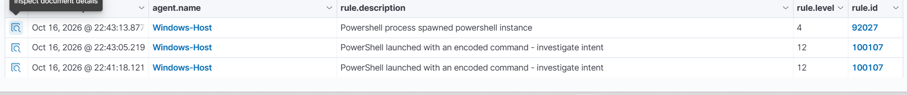

# Project 7 — PowerShell Detection Engineering

**Complete — 16 October 2026. Authorised Windows home-lab detection and tuning exercise.**

Built and tested Wazuh rule **100107** using Sysmon process-creation telemetry. The final rule detected PowerShell spawning another PowerShell process with either **-EncodedCommand** or **-enc**, while a collected ordinary **-Command** control remained under built-in rule **92027**.

The useful engineering result was finding and fixing a coverage gap: the first custom version detected the full switch but missed **-enc**. The shortened-switch event initially received only a generic nested-PowerShell alert. After adjusting the parent dependencies and switch expression, the retest triggered **100107 at level 12**. Full-switch and negative-control regression checks then passed.

## Read the project

- [Detection specification and tuning history](detections/DETECTION-SPECIFICATION.md)
- [Final Wazuh XML](detections/powershell_encoded_command.xml)
- [Test matrix and reproduction steps](tests/TEST-MATRIX.md)
- [Investigation report](investigations/DE-007-INVESTIGATION-REPORT.md)
- [Analyst investigation and response playbook](playbooks/POWERSHELL-TRIAGE.md)
- [14 original screenshots and evidence index](screenshots/README.md)
- [Screenshot hashes](screenshots/SHA256SUMS.txt)

## Environment and telemetry

Existing Windows 11 laptop, Sysmon, Wazuh Windows agent **001 / Windows-Host**, and a VirtualBox-hosted Wazuh manager. The established lab used the Wazuh 4.14.8 OVA; no fresh version check was captured for this session. No new VM was required.

Telemetry: **Microsoft-Windows-Sysmon/Operational, Event ID 1**, decoded as Windows EventChannel data. Examined executable, command line, parent executable, user, integrity level, process identifiers and time. Agent IP is endpoint context, not evidence of a remote attacker.

## Final observed checks

| Test | Observed rule | Result |
| --- | --- | --- |
| -enc, after tuning, 22:41:18 | 100107 / level 12 | Positive match |
| -EncodedCommand regression, 22:43:05 | 100107 / level 12 | Positive match retained |
| Ordinary -Command control, 22:43:13 | 92027 / level 4 | Custom rule did not match the reviewed control event |

Times are dashboard display times on 16 October 2026 (Europe/London, BST). Sysmon utcTime is one hour earlier.

## What this proves

A scoped custom detection was deployed, tested, improved and checked against a benign nonmatching control. MITRE ATT&CK mapping: **T1059.001 — PowerShell, Execution**. Encoded content is not automatically malicious; the positive tests encoded only a harmless Write-Output message and are classified as **benign positives**.

## Limits

The rule depends on the installed parent rules **92027 or 92057**, so it inherits their nested-PowerShell scope. Only Windows PowerShell and the two displayed switch spellings were live-tested. Although the image regex includes pwsh.exe, PowerShell 7 was not tested and the parent dependencies may prevent that path from matching. Other parents, abbreviations, renamed binaries, quoted switches and other obfuscation techniques are not claimed as covered. This is a portfolio lab detection, not a production-validated universal encoded-PowerShell detector. No malicious payload, persistence, network callback or compromise was tested.
